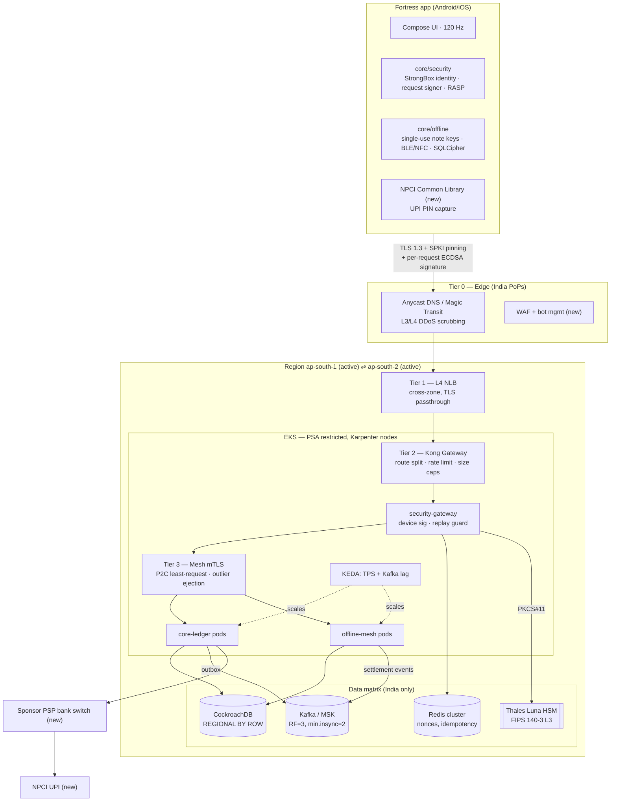

# Fortress — System Architecture (Phase 1)

> **Fortress UPI — Pay Anytime • Offline.** The product name is **Fortress**. The prompt called it "AURA Pay"; this document replaces that name everywhere.

This document covers the structural core: the monorepo layout, the system map, the multi-tier load balancing design, the data tier, and the SLOs. The offline protocol is in [OFFLINE_PROTOCOL.md](OFFLINE_PROTOCOL.md), the security hardening is in [SECURITY.md](SECURITY.md), and the UI system is in [DESIGN_SYSTEM.md](DESIGN_SYSTEM.md).

---

## 0. Engineering ground truth (read first)

Some requirements in the brief can't be met as literally worded. Here is how each one is turned into a commitment the platform can actually keep:

| Brief says | What Fortress commits to | Why |
|---|---|---|
| "<15 ms p99, 10× faster than GPay/PhonePe" | **p99 < 15 ms server-side processing** (gateway ingress → response egress) for every Fortress-owned hop. End-to-end UPI latency is reported separately. | A UPI debit/credit passes through the PSP bank, the **NPCI UPI switch** and the remitter and beneficiary bank CBS. Those hops typically take hundreds of ms to seconds and no app controls them. Mobile RTT in India (30–80 ms on 4G) is also above 15 ms on its own. Faster than competitors means: zero self-inflicted latency, optimistic UI, pre-warmed sessions and offline-first flows. |
| "Executes the payment instantly on scan" | Instant **pre-fill + PIN pad within one frame** for online UPI. Instant one-tap execution for **offline vault / UPI Lite-class small value** only. | NPCI mandates UPI PIN as the second factor for standard UPI. The PIN is captured by the NPCI Common Library (CL), never by our own UI. |
| "Mathematically immune / zero leak / zero spoofing" | Defense-in-depth with **hardware-rooted keys, attestation, E2EE, HSM-held issuer keys and bounded blast radius**. Every residual risk is listed in SECURITY.md §9. | No real system can honestly claim immunity. Auditors and regulators treat that claim as a red flag. |
| "100% SonarQube/Fortify pass" | **CI quality gates fail the build** on any High/Medium SAST, secret, IaC or container finding (see `.github/workflows/ci.yml`). | Writing code doesn't guarantee a pass. The gates enforce it. |
| "Offline mode" | **Pre-funded, hardware-bound offline vault** (UPI Lite X–style). Offline value is moved via single-use StrongBox keys and settles when either party reconnects. | Offline debit of a bank account is impossible. Offline value must be pre-funded, capped by regulation and reconciled. Operating it in production requires NPCI/RBI approval through the sponsor PSP bank. |
| Multi-region "global" data | **India-only regions** (e.g. AWS `ap-south-1` Mumbai + `ap-south-2` Hyderabad). | RBI *Storage of Payment System Data* (2018) requires end-to-end payment data to be stored only in India. |

### Regulatory topology the original diagram was missing

Fortress is a **TPAP (Third-Party Application Provider)**. It cannot talk to NPCI directly. Every online UPI transaction flows through one or more **sponsor PSP banks**:

```
Fortress app ──► Fortress platform ──► Sponsor PSP bank (UPI handle @fortress-psp) ──► NPCI UPI switch ──► Remitter / Beneficiary banks
                       │
                       └── NPCI Common Library (in-app SDK) captures UPI PIN, encrypts with NPCI keys
```

---

## 1. Enterprise monorepo structure

Legend: ✅ = implemented in this repo now · ◻ = planned (named so ownership and boundaries are fixed from day one).

```
fortress/
├── apps/
│   └── mobile/
│       ├── android/                                   Gradle multi-module · AGP 9 · Kotlin 2.4 · Compose · minSdk 31
│       │   ├── app/                               ✅  COMPOSITION ROOT ONLY: Activity, navigation, DI container, screens.
│       │   │   └── src/main/kotlin/com/fortress/upi/       No business rules live here; screens call use-cases.
│       │   │       ├── FortressApplication.kt     ✅  Process init: SQLCipher lib, RASP scan, WorkManager wiring
│       │   │       ├── MainActivity.kt            ✅  Secure window (FLAG_SECURE, overlay hiding), 120 Hz mode request
│       │   │       ├── di/AppContainer.kt         ✅  Hand-rolled DI graph (swap for Hilt when the team grows)
│       │   │       ├── navigation/                ✅  Shared-axis animated navigation, no reflection
│       │   │       └── ui/
│       │   │           ├── dashboard/             ✅  Wealth Snapshot · Quick Send Matrix · Recent Fluid Cards
│       │   │           ├── scanner/               ✅  CameraX + ML Kit (on-device) QR, auto-zoom, focus-on-QR, strict UPI URI parser
│       │   │           └── offline/               ✅  Ambient offline vault UI, NFC tap / BLE nearby pay & receive
│       │   ├── core/designsystem/                 ✅  Tokens (color, type, motion), haptics, particle engine, glass surfaces
│       │   ├── core/crypto/                       ✅  FCE codec, HKDF-SHA256, AES-GCM session, P-256 point validation
│       │   │                                          ↳ byte-for-byte twin of shared/crypto (Go); golden vectors in both test suites
│       │   ├── core/security/                     ✅  DEVICE TRUST BOUNDARY
│       │   │   ├── keystore/                      ✅  StrongBox/TEE key factories, attestation chains
│       │   │   ├── binding/                       ✅  SMS-SIM device binding, SIM-change monitor, request signer
│       │   │   ├── integrity/                     ✅  Play Integrity (Standard API), RASP signals (root/hook/debug/tamper)
│       │   │   └── hygiene/                       ✅  Secret wiping, secure window, clipboard & overlay defenses
│       │   ├── core/offline/                      ✅  OFFLINE ENGINE (see OFFLINE_PROTOCOL.md)
│       │   │   ├── vault/                         ✅  Single-use StrongBox note keys, note selection (DP), spend authorization
│       │   │   ├── protocol/                      ✅  HELLO/OFFER/PAY/RECEIPT state machines, bundle verifier, wire codecs
│       │   │   ├── transport/ble/                 ✅  GATT central (payer) + peripheral (payee), MTU-aware framing
│       │   │   ├── transport/nfc/                 ✅  HCE service (payee) + IsoDep reader (payer), APDU chaining
│       │   │   ├── store/                         ✅  Room + SQLCipher (raw 256-bit key, Keystore-wrapped)
│       │   │   └── sync/                          ✅  WorkManager reconciliation with signed requests
│       │   ├── feature/kyc/                       ◻  Video-KYC, Aadhaar offline e-KYC (XML) verification
│       │   ├── feature/upi-online/                ◻  PSP SDK + NPCI CL integration (PIN capture never touches app code)
│       │   └── baselineprofile/                   ◻  Macrobenchmark-generated baseline profiles (startup + scroll)
│       └── ios/
│           └── FortressCore/                      ✅  SwiftPM core: Secure Enclave signer, design tokens
│               ◻  FortressApp (Xcode target), CoreNFC/CoreBluetooth transports (iOS has no third-party HCE in India)
│
├── services/                                          Go 1.27 · stdlib-only (zero third-party runtime deps = minimal supply-chain surface)
│   ├── core-ledger/                               ✅  DOUBLE-ENTRY LEDGER
│   │   ├── cmd/core-ledger/                       ✅  Composition root (flags/env → wiring → server)
│   │   ├── internal/domain/                       ✅  Posting invariants (Σdebit = Σcredit, INR only, idempotency key). Pure, no I/O
│   │   ├── internal/app/                          ✅  Use-case: PostJournal (idempotent)
│   │   ├── internal/adapters/httpapi/             ✅  Inbound HTTP adapter
│   │   ├── internal/adapters/memjournal/          ✅  In-memory journal (dev/test)
│   │   └── internal/adapters/crdb/                ◻  CockroachDB REGIONAL BY ROW journal + transactional outbox → Kafka
│   ├── offline-mesh/                              ✅  OFFLINE SETTLEMENT & RECONCILIATION ENGINE
│   │   ├── cmd/offline-mesh/                      ✅  Composition root; refuses to start in prod with a non-durable store
│   │   ├── cmd/genfixture/                        ✅  Generates signed fixtures for CI load tests (no secrets persisted)
│   │   ├── internal/domain/                       ✅  Note/bundle parsing + full verification (issuer sig, spend sig, caps, expiry)
│   │   ├── internal/app/                          ✅  SettleBundle use-case → atomic note claims + ledger instructions
│   │   ├── internal/adapters/httpapi/             ✅  POST /v1/offline/settlements
│   │   ├── internal/adapters/memstore/            ✅  Atomic in-memory store (dev/test)
│   │   ├── internal/testkit/                      ✅  Issuer/note/bundle builders shared by tests, benchmarks, fixtures
│   │   └── internal/adapters/{crdb,kafka}/        ◻  Durable claims (UNIQUE(note_id)), fraud events, expiry auto-refund job
│   └── security-gateway/                          ✅  DEVICE-SIGNATURE ENFORCEMENT PROXY
│       ├── internal/devicesig/                    ✅  FCE canonical request, P-256 verify, ±30 s skew, nonce replay guard
│       ├── internal/adapters/{memregistry,memnonce}/ ✅ Dev adapters
│       └── internal/adapters/{pkcs11,redis}/      ◻  Thales Luna HSM (PKCS#11) issuer signing, Redis SET NX nonce store
│
├── shared/
│   ├── crypto/                                    ✅  FCE canonical codec · P-256 ECDSA (DER) · domain-separation constants
│   └── platform/                                  ✅  Hardened HTTP server bootstrap, graceful shutdown, probes, Prometheus metrics
│
├── deploy/docker/go-service.Dockerfile            ✅  Multi-stage → distroless/static:nonroot, UID 65532, read-only, no shell
├── infra/
│   ├── k8s/base/                                  ✅  PSA-restricted namespace, Deployments, KEDA ScaledObjects, PDBs, NetworkPolicies
│   ├── kong/kong.yaml                             ✅  Declarative gateway: routes, limits, size caps, correlation IDs
│   └── terraform/                                 ◻  EKS, MSK, CockroachDB Dedicated, CloudHSM/Luna, WAF — India regions only
├── perf/                                          ✅  k6 scenarios + benchmark budgets (CI performance gate)
├── scripts/perf-gate.sh                           ✅  Fails CI if any Go benchmark exceeds its ns/op budget
├── .github/workflows/ci.yml                       ✅  Secrets → SAST → tests → SBOM/Trivy → perf gate → signed release
└── docs/                                          ✅  This architecture, protocol, security and design specs
```

### Layering rule (enforced in review, then by `depguard` lint)

```
cmd/*  ──►  adapters/*  ──►  app  ──►  domain
                    └────────────────►  domain
domain imports only: stdlib + shared/crypto        (no net/http, no database/sql, no time.Now())
app imports:        domain + its own port interfaces
adapters implement ports; cmd wires adapters into app
```

---

## 2. System architecture map

This is the refined version of the diagram supplied with the brief. Additions are marked **(new)**.



### Request lifecycles

| Flow | Path | Fortress-owned budget |
|---|---|---|
| **Online UPI pay** | App → Edge → NLB → Kong → security-gateway → core-ledger → PSP → NPCI | ≤ 15 ms p99 in-platform; NPCI leg async with status push |
| **Offline pay** | Payer ⇄ payee over BLE/NFC only. No network. | ~150–400 ms tap-to-receipt (dominated by StrongBox signing) |
| **Offline settlement** | Either party's WorkManager → … → offline-mesh | ≤ 15 ms p99 (≈4 ECDSA verifies per 2-note bundle ≈ 0.3 ms CPU) |

---

## 3. Hyper-scale load balancing (multi-tier)

| Tier | Component | Algorithm / mechanism | Why it's fast |
|---|---|---|---|
| **0 — Global** | Anycast + GeoDNS, India PoPs only | BGP anycast → nearest PoP; DNS steering by region health | No DNS failover TTL wait: anycast reroutes in seconds |
| **1 — L4** | AWS NLB (or Magic Transit → NLB) | Flow-hash, cross-zone, **TLS passthrough** to Kong | NLB adds ~100 µs; no L7 parsing at this tier |
| **2 — L7 ingress** | Kong Gateway (OSS/Enterprise) on Envoy-class data plane | Route splitting by path/header, token-bucket rate limiting (per device + per IP), 64 KiB request caps, retries **only** on idempotent routes with retry budgets | Routing table compiled to a trie: route match is µs-scale. "Sub-millisecond route optimization" is the default here, not a feature to bolt on |
| **2b — Trust** | security-gateway | Verifies device ECDSA signature + nonce replay (Redis `SET NX PX`) | P-256 verify ≈ 50–80 µs; Redis RTT in-AZ ≈ 200–400 µs |
| **3 — East-west** | Service mesh (Istio ambient / Linkerd) | **Power-of-two-choices least-request**, zone-aware routing, outlier ejection on 5xx/latency, mTLS (SPIFFE IDs) | P2C avoids herd effects of round-robin under bursty UPI traffic |
| **4 — Data** | Ledger partitioning | Hash-sharded primary keys + `REGIONAL BY ROW` home region by account → leaseholder-local writes | Avoids cross-region consensus on the hot path |

### Auto-scaling

* **Pods:** KEDA `ScaledObject` per service. HTTP services scale on Prometheus **TPS per pod** (target 1,500 req/s/pod) with CPU as a safety net. Stream processors (outbox relay, fraud pipeline) scale on **Kafka consumer lag**. Scale-up policy: +100% per 15 s. Scale-down: −10% per 60 s with a 300 s stabilization window, to avoid flapping during IPL-final-style spikes. See `infra/k8s/base/*-scaledobject.yaml`.
* **Nodes:** Karpenter with a warm buffer of pre-pulled images (low-priority "balloon" pods) so scale-up is pod-start bound (~2–4 s for a static Go binary), not node-boot bound.
* **Stateless services only.** All state lives in CockroachDB/Kafka/Redis, so any pod can serve any request.

### Capacity sketch for 100k TPS (validate with the k6 suite before committing spend)

| Component | Assumption | Count |
|---|---|---|
| core-ledger pods | ~1.5k req/s/pod at p99 < 15 ms (2 vCPU) | ~70 active + 2× headroom = **140** |
| offline-mesh pods | settlements are bursty but light (0.3 ms CPU each) | **10–30** |
| CockroachDB | ~3k write-txn/s per 16-vCPU node (hash-sharded, 3 replicas) | **~40–60 nodes** across 2 regions × 3 AZ |
| Kafka | 100k msg/s × ~1 KB | **6–9 brokers**, 48+ partitions per hot topic |
| Redis | nonce + idempotency, ~200k ops/s | **6 shards** × replica |

---

## 4. Data tier

* **CockroachDB** with `REGIONAL BY ROW` across two Indian regions × 3 AZs. Zone failure is survived automatically. Surviving a full region failure needs a third voting locality (a third Indian region or colo), which is a procurement decision captured as an ADR.
* **Transactional outbox:** ledger writes and their Kafka events commit in one SQL transaction. A relay publishes the events, which gives exactly-once *effect* downstream through idempotent consumers keyed by `posting_id`.
* **Kafka:** `acks=all`, `min.insync.replicas=2`, `enable.idempotence=true`, `RF=3`. Cross-region replication uses MirrorMaker 2 or cluster linking.
* **Redis:** used for nonces, idempotency keys and rate-limit counters only. Nothing in Redis is a source of truth.
* **HSM:** Thales Luna (FIPS 140-3 Level 3) holds the issuer signing keys (note certificates, receiver certificates) and the KEKs. Access is through PKCS#11 from a dedicated signing service with per-key usage policies. Keys never exist outside the HSM boundary.

---

## 5. SLOs and the latency budget (Fortress-owned path)

| Hop | p99 budget |
|---|---|
| Kong route + plugins | 1.0 ms |
| security-gateway (sig verify + Redis nonce) | 1.5 ms |
| Mesh hop (mTLS, warm connections) | 0.5 ms ×2 |
| Service logic | 3.0 ms |
| CockroachDB leaseholder-local write | 6.0 ms |
| Kafka outbox enqueue (async relay) | 0 ms on request path |
| Slack | 2.5 ms |
| **Total** | **≤ 15 ms** |

The CI perf gate (`perf/k6/offline-mesh-smoke.js`) fails the build if `http_req_duration p(99) ≥ 15 ms` on the reference runner. Production SLOs are tracked as burn-rate alerts (1 h / 6 h windows).
