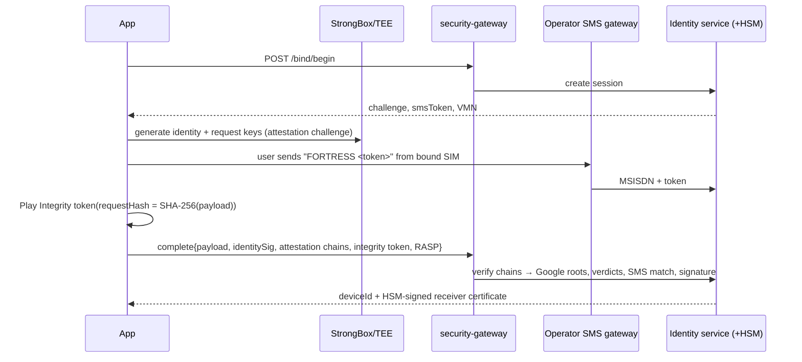

# Fortress "Z+" Security Architecture

Defense-in-depth for a UPI TPAP: hardware-rooted identity, zero-trust transport, hardened runtime, and a pipeline that blocks anything unproven. Every control below links to the code that implements it.

---

## 1. Key hierarchy

```
                ┌───────────────────────── Thales Luna HSM (FIPS 140-3 L3, India DCs) ─────────────────────────┐
                │  Issuer signing keys (note + receiver certificates)   ·  KEKs for data-at-rest  ·  PKCS#11 only │
                └───────────────▲──────────────────────────────────────────────▲──────────────────────────────┘
                                │ signs                                        │ wraps
          ┌─────────────────────┴───────────────┐                  ┌──────────┴──────────┐
          │ Note certs  ·  Receiver certs       │                  │ CockroachDB / Kafka │
          └─────────────────────▲───────────────┘                  │ envelope encryption │
                                │ binds                            └─────────────────────┘
 Device  ┌──────────────────────┴────────────────────────────────────────────────────────────────────────┐
         │ StrongBox: identity key (binding, offers, receipts) · single-use note keys (maxUsageCount=1)      │
         │ TEE:       request-signing key (per API call; fast)  · AES-GCM KEKs (DB key, sealed binding)      │
         │ All non-exportable, attested to Google roots, unlocked-device-only where on the payment path     │
         └───────────────────────────────────────────────────────────────────────────────────────────────────┘
```

## 2. Zero impersonation: cryptographic device binding

The brief asks to match "physical device ID + SIM hardware ID + on-device signature" on every API hit. Android 10+ **forbids** third-party apps from reading IMEI/ICCID, so a literal implementation is impossible, and pretending otherwise would fail an NPCI audit. Fortress binds the same three properties with mechanisms that actually hold:

| Property | Mechanism | Where |
|---|---|---|
| **Physical device** | Hardware key generated in StrongBox/TEE with a server **attestation challenge**. The server verifies the chain to Google's attestation roots: `attestationSecurityLevel`, `verifiedBootState=VERIFIED`, `deviceLocked`, and the app signing-cert digest in `attestationApplicationId`. | `core/security/binding/DeviceIdentity.kt` |
| **SIM / MSISDN** | NPCI-style **outbound SMS** of a one-time token from the bound SIM to a virtual number. The operator gateway delivers it to the server, proving MSISDN possession. Locally, a subscription fingerprint detects SIM swap and **revokes all keys**. | `DeviceBinding.kt`, `SimBindingMonitor.kt` |
| **App + OS integrity** | Play Integrity Standard token **bound to the SHA-256 of the binding payload**. RASP report attached. | `PlayIntegrityClient.kt`, `RuntimeIntegrityScanner.kt` |
| **Every API hit** | ECDSA-P256 signature from the attested request key over an FCE canonical request `{method, path, query, SHA-256(body), ts, nonce, deviceId}`. The gateway enforces ±30 s skew and **single-use nonces** (Redis `SET NX PX`), then strips and re-asserts identity headers. | `RequestSigner.kt` ⇄ `services/security-gateway/internal/devicesig` |

Golden vectors in both test suites guarantee that the Kotlin signer and the Go verifier agree byte for byte.



## 3. Zero spoofing / zero sniffing in transit

* **TLS 1.3 only**, restricted cipher suites (`SecureHttp.kt`). No retries or redirects at the HTTP layer.
* **SPKI pinning** via `network_security_config.xml`: a primary and a backup pin, an expiry, **system CAs only** (user-installed CAs are rejected, which defeats MITM proxies). The release gate refuses to build while placeholder pins remain.
* Edge: TLS terminates at Kong with HSTS preload. East-west traffic runs over **mesh mTLS** with SPIFFE identities.
* Offline radio: **ephemeral ECDH P-256 → HKDF → AES-256-GCM** with per-direction keys, transcript-bound AAD, and payee identity signatures over both ephemeral keys (see OFFLINE_PROTOCOL.md). BLE advertising carries no PII.

## 4. Reverse-engineering shield

| Layer | Control | File |
|---|---|---|
| Binary | R8 full mode, `-repackageclasses`, source-file and line stripping, `Log.*` and Kotlin intrinsics stripped | `app/proguard-rules.pro` |
| Binary (prod) | Commercial obfuscation/RASP (DexGuard or Appdome): string/class encryption, native anti-tamper, self-checksumming | release job (licensed) |
| Root | su paths, Magisk/KernelSU/LSPosed packages (via `<queries>`), `test-keys`, rw `/system` | `RuntimeIntegrityScanner.kt` |
| Hooks | `/proc/self/maps` scan (frida, gadget, lsposed, zygisk…), agent thread names (`gum-js-loop`, `gmain`…), Frida ports 27042/3, Xposed class and stack probes | same |
| Debug | `isDebuggerConnected`, `TracerPid`, debuggable-release flag | same |
| Tamper | Signing-cert SHA-256 pin, installer = Play | same |
| UI | `FLAG_SECURE`, `setHideOverlayWindows`, `filterTouchesWhenObscured`, blank Recents thumbnail | `hygiene/Hygiene.kt` |
| Input | In-app keypad for amounts (no third-party IME). The UPI PIN is captured only by the NPCI CL | `AmountKeypad` |

**Policy:** CRITICAL signals (hooking, a debugger on a release build, a re-signed APK) block money movement locally. Everything else is evidence sent to the server. **The server's decision is authoritative**: client-side checks can be patched out by an attacker with full device control, while attestation and Play Integrity verdicts can't be forged without breaking the hardware.

## 5. Dynamic memory hygiene

* Secrets live in `ByteArray`s that are wiped in `finally` blocks (`wipe()`, `SecretBytes`). Secrets are never converted to `String`.
* ECDH ephemeral keys are destroyed right after derivation. Session keys are wiped on `SessionKeys.close()`.
* The SQLCipher key is a raw 256-bit key built as bytes (`x'…'`). The unwrapped copy is wiped once SQLCipher holds it.
* Caveat: a JVM/ART GC may already have copied a buffer before it is wiped. The mitigation is short lifetimes, with keys kept inside hardware wherever possible.

## 6. Data at rest

| Data | Protection |
|---|---|
| Offline notes, outbox, replay guard | Room + **SQLCipher** (AES-256). Its key is sealed by a StrongBox AES-GCM KEK that is **unlocked-device-only**. Stored in `noBackupFilesDir` |
| Binding record | `SealedStore` (AES-GCM, slot-name AAD, atomic writes) |
| Backups | `allowBackup=false` + data-extraction rules exclude everything |
| Server | CockroachDB encryption at rest (CMEK via HSM), TLS everywhere, **India-only regions** |

## 7. 100% clean deployment pipeline

`.github/workflows/ci.yml`: every job is blocking, every action is SHA-pinned, and the token is read-only by default.

| Stage | Tooling | Fails on |
|---|---|---|
| Secrets | TruffleHog, full history | any verified or unknown secret |
| SAST | Semgrep (`p/default`, `p/golang`, `p/kotlin`, `p/secrets` + `.semgrep/fortress.yml`) | any ERROR/WARNING |
| Go | vet, golangci-lint v2 (gosec, depguard domain-purity, weak-crypto bans), `-race -shuffle` tests, fuzz smoke, **govulncheck** | any finding; business-logic coverage < 80% |
| Android | Lint with security checks fatal, unit tests, R8 release build | any error |
| IaC | Hadolint, Checkov (k8s + Dockerfile + GHA) | any warning |
| Image | distroless/nonroot assertion, no-shell probe, **Trivy** (vuln + secret + misconfig) | HIGH/CRITICAL |
| SBOM | Syft SPDX | n/a (artifact) |
| Performance | Go benchmark budgets + **k6 p99 < 15 ms**, error rate < 0.1% | any breach |
| Quality | SonarQube quality gate (`qualitygate.wait=true`) | gate red |
| Release | Buildx with SLSA provenance + SBOM attestations, **cosign keyless signing by digest** | n/a |

Staging and production pull only **signed digests** (Argo CD + Kyverno `verifyImages`). Clusters enforce PSA `restricted`, default-deny NetworkPolicies, read-only root filesystems, `drop: ALL` capabilities and seccomp `RuntimeDefault` (`infra/k8s/base`).

## 8. Compliance mapping (summary)

| Requirement | Fortress control |
|---|---|
| RBI *Storage of Payment System Data* (2018) | India-only regions for every store, log and backup |
| RBI *Master Direction on Digital Payment Security Controls* (2021) | Device binding, MFA (UPI PIN via NPCI CL + device possession), RASP, secure SDLC (this pipeline), VAPT |
| NPCI UPI device-binding and PIN guidelines | SMS binding, NPCI CL for PIN, per-txn limits enforced by the PSP and issuer |
| UPI Lite / offline circulars | Pre-funded vault, regulatory caps applied at note issuance, auto-refund on expiry |
| CERT-In Directions (Apr 2022) | 6-hour incident reporting runbook; 180-day log retention in India; NTP sync |
| DPDP Act 2023 / DPDP Rules | Data minimisation (opaque receiver IDs instead of VPA hashes), purpose limitation, consent logs |
| PCI DSS v4.0.1 | Applies only where card rails are touched (e.g. RuPay credit on UPI). The tokenization service is segmented as the CDE |

## 9. Residual risks (honest register)

| Risk | Why it remains | Bound |
|---|---|---|
| Offline double-spend on devices without hardware single-use keys | Software enforcement can be bypassed on rooted devices | Vault disabled on enforcement level 0; server detects `CONFLICT` and flags the device |
| Physical hardware attacks on StrongBox | Nation-state-class capability | Low per-device caps limit loss to the vault ceiling |
| Client RASP bypass | The attacker controls the device | Server-side attestation and Play Integrity are authoritative |
| Payee accepts an expired note while their clock is wrong | Offline, nobody has trusted time | The server enforces expiry and grace at settlement; the payee app warns on clock skew at the next sync |
| Relay attacks (BLE) | Physics | Funds are pinned to the signed receiverId, so a relayer gains nothing. SAS confirmation is required |
